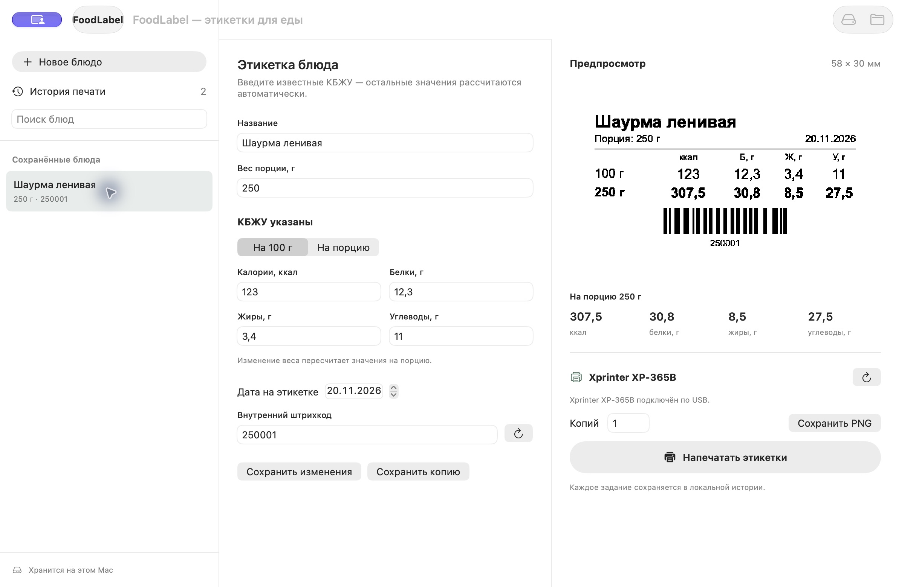

# FoodLabel

Native offline Mac app for Xprinter XP-365B nutrition labels. Russian interface. Apple Silicon, macOS 15 or newer. No internet, account, Homebrew, or driver is required to run the packaged app.

## Install

Download the DMG from [GitHub Releases](https://github.com/Photon94/FoodLabel/releases/latest), open it, and drag **FoodLabel** into **Applications**. Quit an older version before replacing it. Updating the app preserves the database. Release notes state the signing and Apple notarization status of each download.

## Screenshots

**Label editor and live preview** — enter nutrition per 100 g, choose the portion weight, and preview the exact printed label.

Per-portion nutrition input

Enter the values for a portion to calculate the corresponding values per 100 g. Switching the input basis converts the current values.

Local print history

Review past jobs, their label images, copy counts, dates, and USB transfer results. Open a previous label for explicit reprinting.

## Use

1. Open FoodLabel.app. You can move it to Applications.
2. Connect the XP-365B by USB and load 58 × 30 mm labels.
3. Enter the food name, portion weight and known calories/protein/fat/carbs. Select whether those values describe 100 g or a portion. Switching the selector converts existing values; changing the weight recalculates the other basis.
4. Check the preview and date, choose 1–100 copies, then press **Напечатать этикетки**.
5. **Сохранить блюдо** saves a reusable food. **История печати** retains each attempted job automatically, even when the food was not saved.

Comma or dot decimals are accepted. Portion weight supports one decimal place (0.1–10,000 g). Nutrition is calculated with Decimal and displayed to one decimal place. Calories are taken from your input, not inferred from macronutrients. Six-digit Code 128 barcodes are internal identifiers, not registered retail product codes.

## Local database

`~/Library/Application Support/FoodLabel/foodlabel.sqlite`

SQLite stores saved foods, the last draft, the barcode counter, and immutable print snapshots: original inputs, label date, copy count, exact PNG and TSPL bytes, timestamp, transfer result and byte count. Recipe edits do not change old history. Saving a food is optional; recording print jobs is mandatory before USB transmission. Database errors block printing.

**Резервная копия** creates a consistent standalone SQLite backup, including current changes from the write-ahead log. **База данных** reveals the database in Finder. Do not copy just the live .sqlite file while the app is running; use the backup button. To restore: quit FoodLabel, move the whole current FoodLabel data folder aside, create a fresh folder at the same location, and place the backup there named foodlabel.sqlite. Keep the original folder until you verify the restored history.

On reopening a saved food or starting the app, the date defaults to today and copies to 1. Opening a print from history preserves its label date, shows a reminder, and resets copies to 1. Reopening history does not start printing.

“Отправлено” means USB accepted the complete job; inspect physical labels to confirm output. Failed, partial, or interrupted transfers are never automatically retried. A pending job found after restarting becomes “Результат неизвестен”. Check the printer before choosing to reprint.

## Printer

Direct libusb, VID 1fc9 / PID 2016, IEEE 1284 identity XP-365B + TSPL required. Fixed 58 × 30 mm, 8 dots/mm, direction 1, density 8. Gap calibration is preserved. Preview and printing use the same 464 × 240 monochrome raster. The printer receives horizontal BAR runs followed by one PRINT command. No automatic feed, reset, calibration, or test label is sent on launch.

If the printer is unavailable, reconnect it, turn it on and close other printing applications, then click the refresh icon.

## Build from source

Requires Apple command-line development tools and libusb headers/library at /opt/homebrew (override USB_PREFIX if needed). Run `bash test.sh`, then `bash build.sh`. The script prints the output path in the Mac temporary folder. APP_PATH can change the output location; use a local folder outside iCloud Drive so cloud metadata does not interfere with signing. Tests render and scan a barcode, verify nutrition conversion and invalid input, and exercise SQLite persistence, snapshots, recovery and backup; they do not print. macOS graphics access is required for rendering tests.

For an isolated manual test, set FOODLABEL_DATA_DIR to a temporary directory before launching the executable. Normal launches use the database path above.

The bundled libusb license and upstream source reference are in Packaging and in the app’s Resources folder.

## Create a release DMG

Run `bash package-dmg.sh` to build a drag-to-Applications installer in `dist/`. It bundles libusb and uses a local ad-hoc signature by default. Set `SIGN_IDENTITY` to a Developer ID Application identity in the Mac keychain to sign with hardened runtime and a secure timestamp. Set `NOTARY_PROFILE` to an existing notarytool keychain profile to additionally submit to Apple and staple the resulting ticket. No certificate or credential belongs in this repository.

The script verifies the disk image and writes `dist/SHA256SUMS.txt`. It refuses to overwrite an existing release. Update Packaging/Info.plist for a new version, run the tests, create a matching Git tag, then attach the DMG and checksum file to that tag's GitHub release. This repository does not use an unattended cloud signing service.
